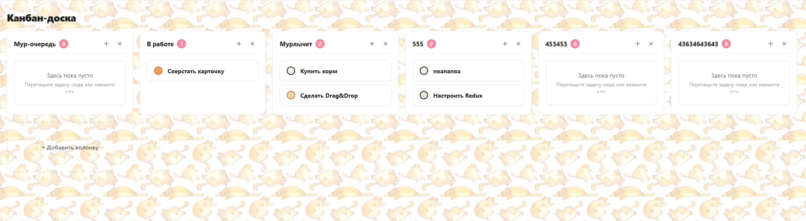
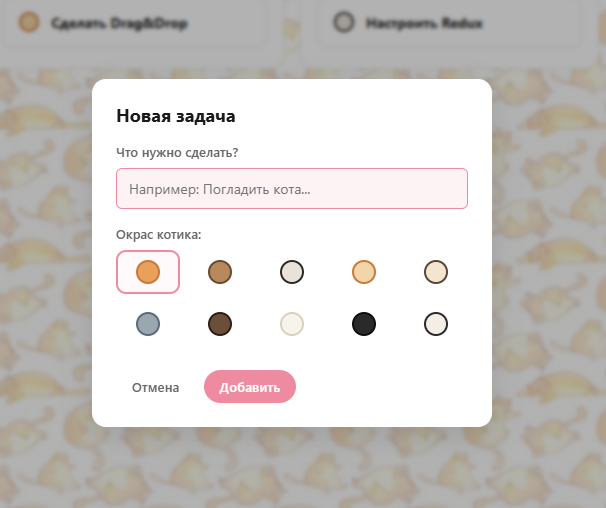

# 🐾 Котиковая Канбан-доска

Интерактивная Канбан-доска (аналог Trello) с милым котиковым дизайном. Проект создан для демонстрации навыков современной Frontend-разработки, включая тестирование, CI/CD и доступность.

## 🖥 Главный экран

## 🎨 Создание задачи

## 🚀 Стек технологий
*   **Сборка:** Vite
*   **Фреймворк:** React 18 (TypeScript)
*   **Стейт-менеджер:** Redux Toolkit (RTK)
*   **Формы и валидация:** React Hook Form + Zod
*   **Стилизация:** SCSS Modules
*   **Хранение данных:** localStorage + Экспорт/Импорт в JSON
*   **Тестирование:** Vitest + React Testing Library
*   **Качество кода:** ESLint + Prettier
*   **Деплой:** GitHub Actions + GitHub Pages

## ✨ Функционал
*   **Управление задачами:** Создание, редактирование (название + окрас котика) и удаление.
*   **Drag-and-Drop:** 
    *   Перетаскивание карточек между колонками.
    *   Сортировка карточек внутри колонки.
    *   Визуальная подсветка зоны сброса.
*   **Управление колонками:** Добавление, переименование и удаление.
*   **Работа с данными:** Автосохранение в `localStorage`. Возможность **Экспорта** доски в JSON-файл и **Импорта** из него (для переноса данных между устройствами или резервного копирования).
*   **UX/UI:**
    *   Адаптивная верстка.
    *   Empty States (заглушки для пустых колонок).
    *   Кастомный паттерн и иконка сайта.
*   **Доступность (a11y):** Управление с клавиатуры (Tab, Enter, Esc), ARIA-атрибуты, фокус-стили.

## 🧠 Архитектурные решения и качество кода
1.  **Оптимизация рендера:** Компоненты `TaskCard` и `Column` обернуты в `React.memo`, а селекторы задач мемоизированы через `createSelector`. Это предотвращает перерисовку всей доски при перетаскивании.
2.  **Кастомные хуки:** Логика Drag-and-Drop вынесена в хук `useDragAndDrop`.
3.  **Валидация форм:** Модалки используют React Hook Form (без лишних ререндеров) и Zod для строгой типизации и проверки ввода.
4.  **Тестирование:** Настроен Vitest и React Testing Library. Покрыты юнит-тестами редьюсеры Redux (логика перемещения и удаления) и компонент карточки.
5.  **CI/CD:** Настроен GitHub Actions. Пайплайн автоматически проверяет код линтером (ESLint), форматирование (Prettier), запускает тесты и деплоит проект на GitHub Pages.

## 🛠 Установка и запуск

1. Клонируйте репозиторий:
   git clone https://github.com/EHOTCKuu/kanban-board.git
2. Перейдите в папку проекта:
   cd kanban-board
3. Установите зависимости:
   npm install
4. Запустите сервер для разработки:
   npm run dev

### Скрипты
*   `npm run dev` — запуск локального сервера.
*   `npm run build` — сборка проекта.
*   `npm run lint` — проверка кода линтером.
*   `npm run format` — автоформатирование кода через Prettier.
*   `npm test` — запуск тестов (Vitest).
*   `npm run test:ui` — запуск тестов с графическим интерфейсом.

## 🌐 Демо
Посмотреть работающую версию можно по ссылке: [https://EHOTCKuu.github.io/kanban-board/](https://EHOTCKuu.github.io/kanban-board/)